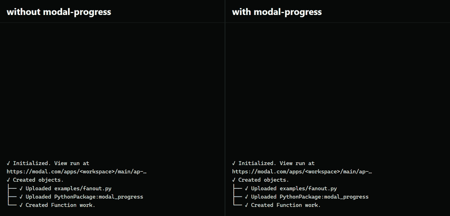
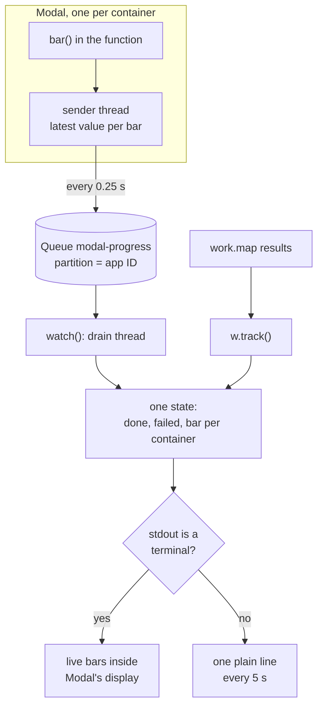

<h1 align="center">modal-progress</h1>

<p align="center"><b>Live progress from inside Modal containers.</b><br>
One bar per container when you are at a terminal, and plain log lines when an agent is the one reading.</p>

<p align="center">
  
</p>

<p align="center">The same real job on Modal, sped up. Left is the log an agent gets from <code>modal run</code> today, right is the same log with modal-progress.</p>

When you fan a function out with `.map`, the function has no way to tell you how far along it is, and `modal run` only shows a count of finished inputs. That count is drawn as a live terminal bar, so when the output goes to a file or a pipe, the log gets no progress at all until the run ends. That is how a background coding agent runs it, so the agent can't tell a slow job from a stuck one.

## How it works

1. **Report.** Inside the function, wrap a loop in `bar()`, the same way you would use tqdm. Each update goes into a background thread, which keeps only the latest value per bar and sends a batch every quarter second to a [Modal Queue](https://modal.com/docs/reference/modal.Queue), in a partition named after the app ID. The function's signature doesn't change.
2. **Collect.** On your side, `watch(app)` reads that partition in a background thread, and `w.track(...)` counts results as they come back from the map, failures included.
3. **Draw.** If stdout is a terminal, you get an overall bar and one row per container, added to Modal's own live display. If it isn't, you get one plain line every 5 seconds, plus a line the moment an input fails. The lines have a fixed shape, so an agent can grep them.
4. **Or change nothing.** `modal-progress run app.py` is a drop-in for `modal run` that adds plain lines for Modal's own finished-input count. You get no per-container detail this way, and you don't edit any code.

```python
import modal
from modal_progress import bar, watch

app = modal.App("example")
image = modal.Image.debian_slim().add_local_python_source("modal_progress")

@app.function(image=image, max_containers=6)
def work(i: int) -> int:
    for step in bar(range(40), desc=f"input {i}"):
        ...  # one step of real work
    return i

@app.local_entrypoint()
def main():
    xs = range(60)
    with watch(app, name="work") as w:
        results = list(w.track(work.map(xs, return_exceptions=True), total=len(xs)))
```

## System design

Progress travels on its own path next to the map's results and joins them in one state on your side.



## Results

All runs are the same shape: 60 inputs over 6 containers, with input 37 raising an error partway through. The full logs are in [`repro/`](repro/).

| What an agent's log file got | Code changed | Progress lines | Run time |
|---|---|--:|--:|
| `modal run`, today ([log](repro/run-nontty.log)) | none | 0 | 45 s |
| `modal-progress run` ([log](repro/run-agent.log)) | none | 8 | 47 s |
| `bar()` in the function, `watch()` around the map ([log](repro/run-watch.log)) | 4 lines | 13 | 57 s |

The third run is a different script ([`examples/fanout.py`](examples/fanout.py)) with 40 steps per input, so its run time isn't comparable with the first two. In that run, 524 progress events from all 6 containers reached the caller, covering all 60 inputs. The failure line was printed as soon as input 37 failed, not after the run ended.

The cost of a `bar()`, measured inside a Modal container by [`scripts/overhead.py`](scripts/overhead.py) as a 200,000-step loop with and without one:

| Version | Added per step | On a 1 ms step |
|---|--:|--:|
| First version | 2,154 ns | 0.22% |
| Current | 216 ns | 0.02% |

The first version read an environment variable on every update, which was 80% of the cost. The current one reads it once per bar, so the cost dropped 90% (measured).

What this doesn't do yet:

- **It relies on three private Modal internals.** A container finds its app ID through `App._get_container_app()`, the terminal view joins Modal's live display through a private attribute, and `modal-progress run` wraps a private method. All three are guarded, so if one changes, the result is no progress output, not a broken job. It was tested on modal 1.6.1. You can set `MODAL_PROGRESS_KEY` to skip the first one.
- **It only covers `modal run` and `app.run()`.** A deployed function called from another app reports to its own app's partition, so the caller doesn't see it.
- **Progress lags a little.** Bars send at most every 0.5 s and the sender batches every 0.25 s. The delay couldn't be measured end to end, because the container clocks were about 2 s off from the laptop's.
- **The finished-input counter belongs in Modal itself.** `modal-progress run` patches it from outside. The cleaner fix is a few lines in Modal's client, and that is the next step.

## Run it

```bash
pip install git+https://github.com/EnesYilmazcode/modal-progress
git clone https://github.com/EnesYilmazcode/modal-progress && cd modal-progress
modal run examples/fanout.py                          # real containers, live bars
modal run examples/fanout.py > log.txt                # real containers, plain lines
modal-progress run repro/slow_map.py > log.txt        # an unmodified script, plain lines
```

`MODAL_PROGRESS` picks the output (`rich`, `plain` or `off`, where `off` also stops the containers from sending), and `MODAL_PROGRESS_INTERVAL` sets the seconds between plain lines. Each example run takes about a minute of six small CPU containers, which we estimate at under a cent of Modal compute.

To rebuild the GIF in this README:

```bash
modal run examples/fanout.py --record run.jsonl       # record a real run
python scripts/export_trace.py run.jsonl scripts/render/trace.json
python scripts/capture_demo.py gif assets/media/with-and-without.gif
python -m pytest -q                                   # 27 tests
```

| Folder | What's in it |
|---|---|
| [`modal_progress/`](modal_progress/) | `bar()` and the sender, `watch()`, the state, both views, agent mode, the simulator |
| [`examples/`](examples/) | The 60-input fan-out used for every number above |
| [`repro/`](repro/) | The silent-log reproduction and the three saved logs |
| [`scripts/`](scripts/) | Overhead benchmark, and the page that draws the GIF from a recorded run |
| [`tests/`](tests/) | Unit tests and a simulated map end to end, run in CI on Linux and Windows |

## Credits

Built on [Modal](https://modal.com) (Queues for transport, the client's map progress counter for agent mode) and [Rich](https://github.com/Textualize/rich) for the terminal view. The bar API follows [tqdm](https://github.com/tqdm/tqdm).
